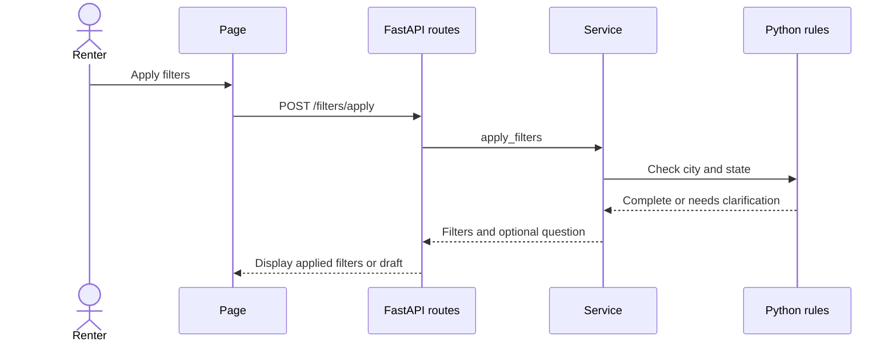

# PR Review Diagrams

Make the change easier to review with a concise Mermaid diagram in the PR
**description**, alongside the summary and test evidence. Invoke during PR
preparation and refresh the diagram when the implementation changes. This skill
is an agent workflow, not a background GitHub event listener.

## Build the explanation from the change

Read the final diff against the actual PR base and enough surrounding code to
trace the changed path. For an existing PR, read its current description too.
Choose the diagram that answers the reviewer's main question:

| Changed behavior | Useful diagram |
| --- | --- |
| Calls, endpoints, or interactions over time | Sequence diagram |
| Components, dependencies, or data movement | Flowchart |
| Draft/ready/error states or transitions | State diagram |
| Database entities and relationships | ER diagram, only for a schema change |

Usually one small diagram is enough. Add another when it explains a distinct
review question. Focus on the changed behavior, not every module in the project.
Use real component/function/endpoint names from the code, with short readable
labels. Show important alternative/error paths when they are part of the change.
Do not depict planned functionality as implemented, invent infrastructure, or
infer a database or model call merely because the project will eventually use it.

## Required PR description slot

Keep the repository's required sections and add **## Diagram** between Summary
and Test plan. The section contains a one-sentence caption explaining what to
look for and a fenced `mermaid` block. If the change only edits prose/formatting
and changes no flow, structure, schema, or state, keep the section with a short
statement that there is no such change; do not invent a diagram to fill space.

Example for a direct-filter endpoint that deliberately avoids model access:

````markdown
## Diagram

Apply validates the edited filters directly; it never calls the model.


````

Use plain GitHub-supported syntax: simple identifiers, quoted flowchart labels,
and a complete fenced block. Trace every arrow against the code; check actor
names, return direction, changed branches, and the caption. Check Mermaid syntax
with an available parser/renderer when practical. Do not claim a render check
that was not performed; otherwise leave visual confirmation for the reviewer.

## Create, update, and verify

Use the already-authorized PR workflow. For `gh pr create`, write the complete
body to a UTF-8 temporary file and pass `--body-file` so Mermaid fences and line
breaks survive shell parsing. For an existing PR, replace the outdated Diagram
section, preserving its Summary, Test plan checkboxes, and unrelated review notes;
do not append duplicate diagrams on each update.

After creation/editing, read the saved body with `gh pr view <number> --json body`
and confirm that the caption, Mermaid fence, and existing sections survived.
When scope changes, update both the prose and diagram to match the final code.

Do not paste keys, private configuration values, or sensitive request contents
into labels. A diagram illustrates behavior; it is not evidence that tests or
runtime checks passed. Keep test claims tied to commands actually run.
