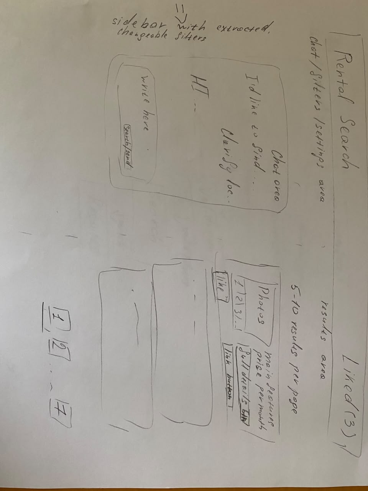
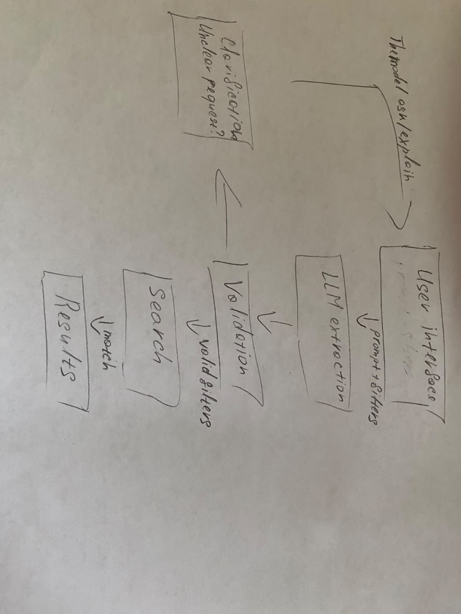

# Final Project Proposal

Igor Rodin

## Project goal

I want to build an apartment rental app that helps renters find relevant listings using natural English. Users will describe what they need, and the app will turn their words into search filters. They can check the filters and change them.

## Intended user and problem

The intended users are renters who want to find a property that meets their needs. They often jump across different platforms, such as Zillow and Apartments.com. Standard filters can also feel overwhelming, especially when a user wants to describe several needs at once.

## Example input

For example, a user could write: “I want to find a 2-bedroom apartment in Downtown. It must be pet-friendly because I have a dog.” The app should identify the bedroom and pet requirements and ask what location the user means before searching.

## Sample input set

| ID | Synthetic input | Expected result |
| --- | --- | --- |
| 1 | I want a 2-bedroom apartment on Oahu Downtown. It must allow dogs. | Keep 2 bedrooms and dogs; if the model struggles to identify the location, the model asks for clarifications regarding it. |
| 2 | Find a 2-bedroom apartment in Honolulu, HI, for at most $2,500 per month that allows dogs. | Extract the filters and return only qualifying test records. |
| 3 | Keep everything else, but lower my budget to $2,200. | With ID 2 request as context, change only the maximum rent and rerun the result. |
| 4 | Find a 2-bedroom apartment in Austin, Texas, with parking. | Use Austin, TX, 2 bedrooms, and parking. Leave an unspecified budget and pet filters empty. The model looks up for amenities (parking) in database columns where it could be mentioned (dedicated ”amenities” or in “description” columns) |
| 5 | Find a 2-bedroom apartment in Honolulu, HI, for at most $100 per month. | With no such record, show no matches and suggest the user to change the request. |
| 6 | Find a cheap place near campus. | Ask which location and what budget. |
| 7 | What is the capital of France? | Explain that this app searches rentals. Do not change the current search. |

## Expected result and value

The user should see a list of properties that meet the search criteria. The original prompt and extracted filter settings will stay visible. The user can give clarifications or change the filters directly, inspect a listing, and add it to a ‘Liked’ list.

## Big-picture sketch

- Chat area: the user writes a rental request and answers questions about missing details.

- Editable filters (initially hidden sidebar): the user checks what the model understood and can apply changes directly.

- Results: cards show the info about property

- Liked: returns selected listings saved in persistent storage.

## Workflow or component sketch

The following diagram shows the path from a request to a result. If required information is missing, the app asks a follow-up question.

## Data source and access

To simplify data collection, I plan to use the[Apartment Rent Data dataset on Kaggle](https://www.kaggle.com/datasets/shashanks1202/apartment-rent-data/data) instead of collecting live data from different rental platforms through APIs. This dataset contains information about 100,000 apartment rentals. Although it is intended for machine learning, I think it is useful sample data for this project because it includes essential attributes such as descriptions, prices, amenities, and locations. It also includes latitude and longitude, which could be used to show properties on a map if needed.

The main limitation is that the dataset does not include property links or photos.

## Up to three core features

1. Plain-English search: extract location, bedrooms, budget, pet needs, and supported amenities. Ask a short follow-up question when essential information is missing

2. Editable search: show the extracted filters, allow direct changes, and return matching listings

3. Liked list: let users add, remove, and reopen selected listings

## LLM role

The model's job is to translate a message into a small set of search fields and identify what is unclear. The application will validate those fields and retrieve the listings.

## Data use

The LLM will extract the user's requirements, such as location, budget, bedrooms, and pet preferences. The application will check these values and pass them to a search function that uses SQL queries to retrieve matching records. The model may call this function as a tool, but it will not write SQL directly.

## Saved records

Version one will use SQLite through Python's built-in `sqlite3` module for persistent storage of conversations, search history, filters, results, and liked listing IDs. Saved data will remain available after the page is closed or reloaded. There will be no accounts, login, or authentication.

## Searchable text

For the first version, I will use keyword search to find relevant information in listing descriptions and amenities. For example, the app could search for “parking” or “gym” words in the description column. Later, I will explore whether searching by meaning helps find relevant listings.

## Human review

Users will review the model's interpretation through visible extracted filters.  Searches can run automatically when the request is clear. Ambiguous users' requirements will need clarifications.

## One failure case

If a request has no usable location, the app will pause the new search and ask for clarification. It will preserve earlier work and apply the new request only after the missing information is resolved.

## Three acceptance criteria

1. Given a small test dataset with known matching and nonmatching records, when the user asks for a 2-bedroom apartment in Honolulu, HI, at or below $2,500 per month that allows dogs, then the app shows those filters and returns exactly the qualifying records. Records above the budget or with unknown dog permission are not displayed.

2. Given an active Honolulu search with 2 bedrooms and dogs allowed, when the user says ‘Lower my budget to $2,200,’ then only the budget changes and results update.

3. Given a user asks for a 2-bedroom apartment in Downtown, then the app asks for the city and state and does not execute the incomplete search.

## Outside version one

- Accounts, login, and authentication

- A mobile app

- Real up to date data

## Open questions

Decisions I need to make include which model to use and whether one model is enough for all tasks or different models would work better for specific tasks. I also need to decide whether the interface needs changes.

The main uncertainties are:

- Will the LLM stay within its intended tasks, such as extracting search filters instead of responding to unrelated requests?

- How accurately will it identify fields such as location, budget, bedrooms, and amenities? How will it handle missing or unclear information?

- If I add RAG (possible feature: the model can answer user questions about rental regulations), can one chat correctly distinguish between a rental search, a general rental question, and a follow-up message? Can answers based on retrieved documents stay accurate and clearly show their sources?

## Next investigation

My next investigation will explore RAG using a small set of official rental documents to check whether the app gives clear answers with sources and recognizes when information is missing. I will also test whether one chat can handle rental searches, follow-up questions, and regulation questions without mixing up the tasks.
